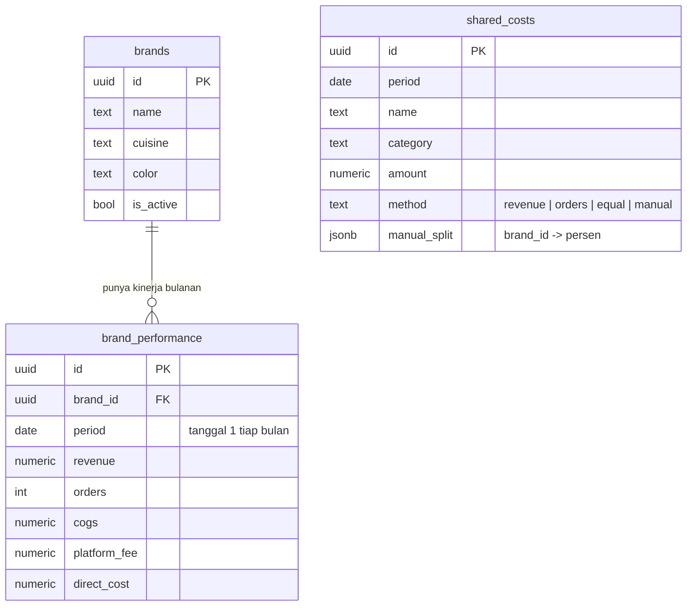

# Selaras

Aplikasi web untuk membagi biaya bersama dan melihat laba tiap brand di cloud kitchen multibrand.
Frontend: HTML, CSS, JS. Backend: Supabase (PostgreSQL). Tanpa login.

## Struktur folder

```
selaras/
├─ index.html              versi satu file (CSS + konfigurasi + JS sudah menyatu)
├─ frontend/               versi terpisah, isinya sama dengan index.html di atas
│  ├─ index.html           kerangka halaman
│  ├─ css/style.css        tampilan
│  └─ js/
│     ├─ config.js         URL & anon key Supabase
│     └─ app.js            data, perhitungan alokasi, tampilan, aksi
├─ backend/
│  ├─ 01_schema.sql        3 tabel + 2 view + akses (wajib dijalankan di Supabase)
│  └─ 02_seed.sql          data contoh (opsional)
└─ README.md
```

Pakai salah satu saja:

- **`index.html` di folder paling luar**: paling praktis, cukup satu file untuk dibuka atau diunggah.
- **Folder `frontend/`**: lebih mudah dibaca dan diubah, karena CSS dan JS dipisah.

Kedua versi menjalankan aplikasi yang sama. Jika ada perubahan di salah satunya, samakan juga di yang lain.

## ERD



`shared_costs` tidak punya foreign key ke brand. Hubungannya lewat kolom `period` dan `method`:
saat laporan dihitung, setiap biaya dibagi ke brand yang punya baris `brand_performance` di bulan yang sama.

## Cara pasang

1. Buat project di supabase.com.
2. Buka SQL Editor → New query → tempel isi `backend/01_schema.sql` → Run.
   Untuk data contoh, ulangi dengan `backend/02_seed.sql`.
3. Buka Project Settings → API, lalu salin Project URL dan anon key.
4. Isi kedua nilai itu di tempat yang sesuai dengan versi yang dipakai:
   - versi satu file: di `index.html` (cari `GANTI_DENGAN` dengan Ctrl+F)
   - versi terpisah: di `frontend/js/config.js`
5. Buka file `index.html` di browser, atau unggah ke Netlify / Vercel / GitHub Pages.

## Cara pakai singkat

1. **Daftar brand**: tambahkan brand yang berjalan di dapur.
2. **Kinerja brand**: isi omzet, pesanan, HPP, komisi platform, dan biaya langsung tiap brand per bulan.
3. **Biaya bersama**: isi sewa, listrik, gaji tim, dan biaya lain, lalu pilih cara bagi tiap biaya.
4. **Ringkasan** dan **Hasil alokasi**: lihat laba tiap brand, lalu cetak atau unduh CSV.

Cara bagi biaya: proporsi omzet, proporsi pesanan, dibagi rata, atau persentase manual (harus 100%).

## Rumus

- Laba kontribusi = omzet − HPP − komisi platform − biaya langsung lain
- Bagian biaya bersama = jumlah biaya × porsi brand
- Laba bersih = laba kontribusi − total bagian biaya bersama
- Omzet impas = biaya bersama brand ÷ margin kontribusi

## Catatan keamanan

Karena tanpa login, siapa pun yang memegang alamat aplikasi dan anon key bisa membaca dan mengubah data.
Karena kunci tersimpan di dalam `index.html` / `config.js`, gunakan repo GitHub Private dan bagikan alamat aplikasi
hanya ke tim internal. Bila nanti perlu login, ganti kebijakan RLS di akhir `backend/01_schema.sql`.
