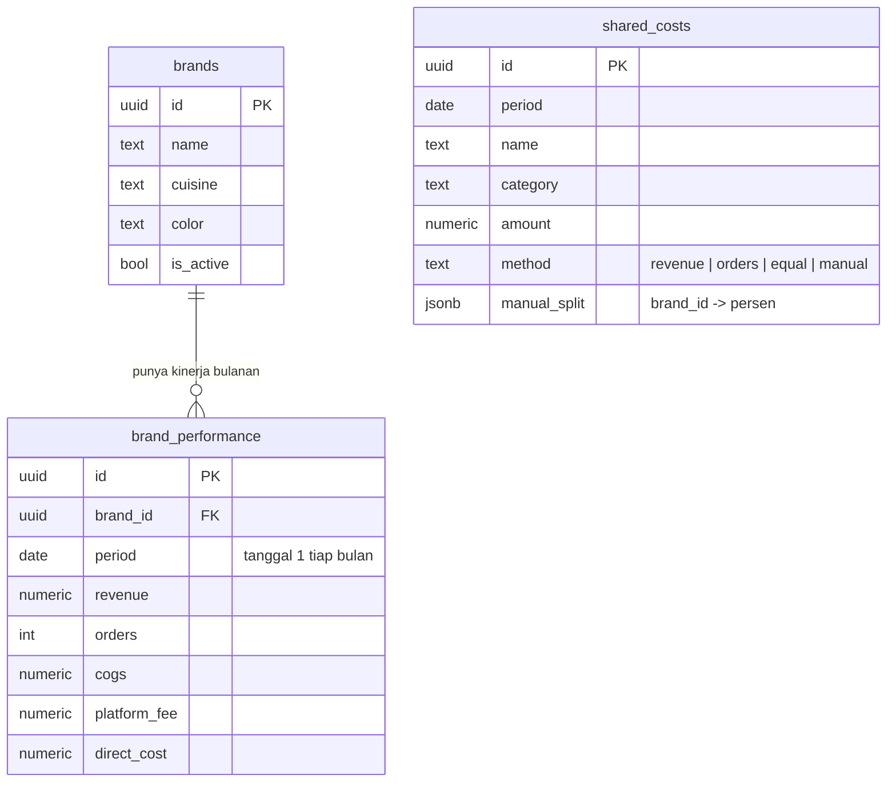

# Selaras

Aplikasi web untuk membagi biaya bersama dan melihat laba tiap brand di cloud kitchen multibrand.
Frontend: HTML, CSS, JS. Backend: Supabase (PostgreSQL). Tanpa login.

## Struktur folder

```
selaras/
├─ index.html          kerangka halaman
├─ css/style.css       tampilan
├─ js/
│  ├─ config.js        URL & anon key Supabase (isi sendiri)
│  └─ app.js           data, perhitungan alokasi, tampilan, aksi
├─ sql/
│  ├─ 01_schema.sql    3 tabel + 2 view + akses
│  └─ 02_seed.sql      data contoh (opsional)
└─ README.md
```

## ERD



`shared_costs` tidak punya foreign key ke brand. Hubungannya lewat kolom `period` dan `method`:
saat laporan dihitung, setiap biaya dibagi ke brand yang punya baris `brand_performance` di bulan yang sama.

## Cara pasang

1. Buat project di supabase.com.
2. SQL Editor → jalankan `sql/01_schema.sql`, lalu (opsional) `sql/02_seed.sql`.
3. Project Settings → API → salin Project URL dan anon key ke `js/config.js`.
4. Buka `index.html` dengan Live Server (VS Code) atau unggah folder ke Netlify / Vercel / GitHub Pages.

## Rumus

- Laba kontribusi = omzet − HPP − komisi platform − biaya langsung lain
- Bagian biaya bersama = jumlah biaya × porsi brand (omzet, pesanan, rata, atau persentase manual)
- Laba bersih = laba kontribusi − total bagian biaya bersama
- Omzet impas = biaya bersama brand ÷ margin kontribusi

## Catatan keamanan

Karena tanpa login, siapa pun yang memegang alamat aplikasi dan anon key bisa membaca dan mengubah data.
Simpan alamatnya untuk tim internal. Bila nanti perlu login, ganti kebijakan RLS di akhir `01_schema.sql`.
